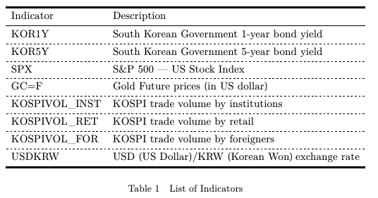
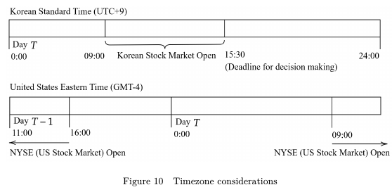
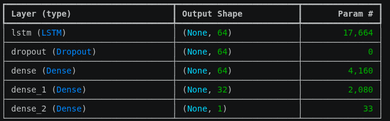
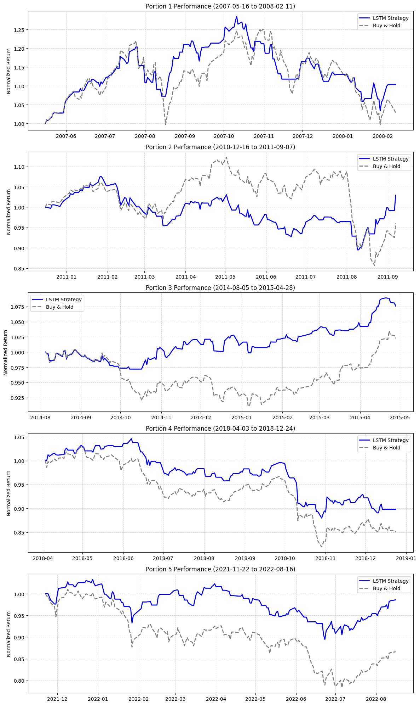

# KOSPI-daily-direction-prediction
This is a project utilizing LSTM networks to predict the daily movement (bull/bear) of the KOSPI composite index, which is the prime stock market index of South Korea.

In this project, I used not only the KOSPI index but also various macroeconomic/microeconomic indicators to predict the daily movement of the KOSPI index.

## Directory
```
.
├── dat/                    # Auto-generated results
│   ├── *.csv/              # Labeled images + kernel grid images
├── Granger Results.xlsx    # Results for the Granger causality test
├── granger.ipynb           # Granger causality test
├── KOSPI_LSTM.ipynb        # Actual model development
├── model.keras             # KOSPI prediction model
├── Abstract.pdf            # Abstract for this project
```

## Methodology
This investigation is broadly split into two parts: selecting relavent economic indicators and building the ML model.

### Selecting Economic Indicators
First, I determined the economic indicators that can effectively predict the future movement of the KOSPI index. I started with these economic indicators that are *believed* to be related to the KOSPI index.



*image excerpt from original EE (Extended Essay) work*

I detrended the data using log first difference to make the data stationary. I finally conducted SSR based F test to determine Granger Causality for each indicators. The results for the SSR based F tert are shown in *Granger Results.xlsx*.

The indicators with minimum *p<0.05* (among the lags of up to 10 days used), which were S&P 500 index, Gold price and USD/KRW exchange rate, were selected as the meaningful economic indicators to predict the KOSPI index.

### Time difference consideration
In developing ML model for this project, it is important to recognize the time difference in economic indicators. Specifically, US based economic indicators should be all lagged by one day since it is impossible to know, for example, the S&P 500 price of that day while the Korean stock market is open, as shown in the diagram below.



*image excerpt from original EE*

Therefore, I lagged all US-based economic indicators by 1 day when preparing the features for the model.

### Training the model
*Code for these steps is shown in `KOSPI_LSTM.ipynb`.*

I first imported the data from `csv` source in `dat/`. Then, after aligning the dates, I split the dataset into five portions, then preparing 70% training, 20% validation and 10% test. The rationale behind this decision is that stock markets in short timespans might exhibit monogamous trend. Therefore, I determined that the model will benefit more by being trained and evaluated on various market situations across different timespans.

I then built a model with an LSTM layer, as well as a dropout and two conventional dense layers. The model looks like the following:



## Results
Evaluating the model against the test dataset demonstrate that the model was able to predict the next-day movement of the index by **62.0%** accuracy.

This accuracy outperforms any of the naive methods: random walk, always predicting bear and always predicting bull, as shown in the following table.

| Strategy | Prediction Accuracy |
| --- | ---
| Always predict bear | 46.8% |
| Random walk | 50.0% |
| Always predict bull | 53.5% |
| Model | 62.0% |

### Backtesting
To determine the usefulness of this model, I performed a backtest on the test data, with the following strategy:
* We always have 100% cash or 100% stock (KOSPI ETF).
* If the model predicts bull:
  * If we currently have cash, buy it.
  * If we currently have stock, keep it.
* If the model predicts bear:
  * If we currently have cash, keep it.
  * If we currently have stock, sell it.
 Results show that we can gain 4%p-12%p alpha using the strategy over the five different 8-month testing periods.

The results are as follows.



Backtesting shows **4.6% to 12.0%** outperformance by the LSTM model. However, it must be noted that this backtesting did not account slippage or transcation costs.

## Recognition
This project was completed as a formal requirement for the International Baccalaureate Diploma Programme May 2024 session, with some modification. This work resulted in an 'A' grade for the component.

## Acknowledgement
Thank you to Mr Tajvir Singh--then International Baccalaureate Computer Science teacher at NLCS Jeju--for supervising this project.
